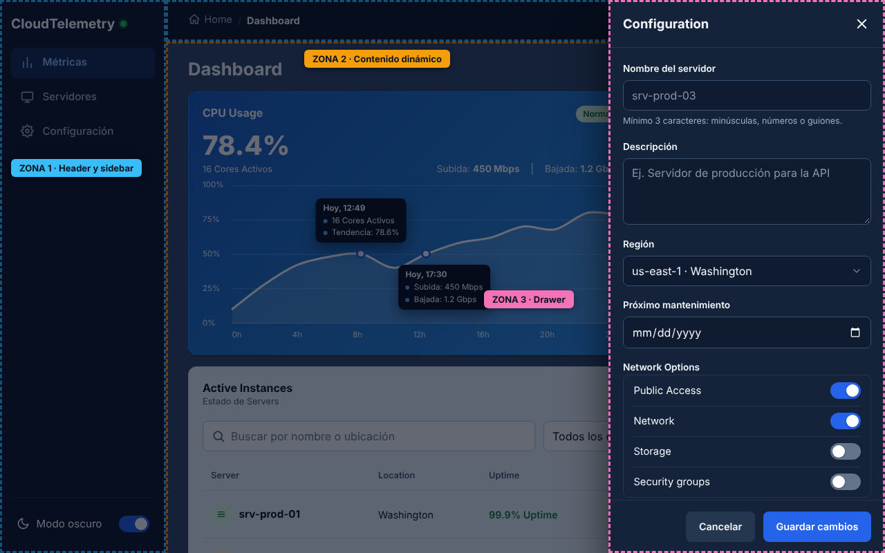

# Fase 3 · Arquitectura de interfaz en tres zonas

Azul: Zona 1 (navegación). Ámbar: Zona 2 (contenido). Rosa: Zona 3 (interacción).

## Zona 1 · Navegación

| Requisito | Implementación | Archivo |
|---|---|---|
| Header superior fijo | `.app-header` con `position: sticky; top: 0` | `css/` |
| Sidebar persistente o retráctil | Fija en escritorio (≥ 1024 px). En móvil es un panel lateral que se abre con ☰, se cierra con `Esc`, con la capa oscura o al elegir una opción | `css/`, `js/` |
| ¿Dónde estoy? | Elemento activo del menú (`aria-current="page"`, fondo azul) y breadcrumbs `Home / Dashboard / Servidores`. En móvil los breadcrumbs aparecen sobre el título | `index.html`, `js/` |
| ¿De dónde vengo? | Enlace "‹ Volver a Dashboard" (o "Volver a Servidores") que aparece tras cambiar de vista y lleva a la vista anterior | `index.html`, `js/` |
| ¿A dónde puedo ir? | Sidebar con las tres opciones y su icono: Métricas, Servidores y Configuración | `index.html` |

El menú y el breadcrumb también siguen el scroll: al bajar hasta la tabla se marca "Servidores", y al subir se marca "Métricas".

## Zona 2 · Contenido dinámico

- **Tarjetas de estado:** CPU, RAM y Bandwidth en Bento Grid (3 columnas en escritorio, 2 en tableta, 1 en móvil).
- **Gráfica de métricas:** línea de CPU en 24 h, dibujada con SVG, con marcadores y tooltips.
- **Tabla de servidores:** búsqueda por nombre o ubicación, filtro por estado y paginación de 5 filas. En móvil cada fila se convierte en tarjeta.
- **Estados vacíos:** si el filtro no encuentra nada, aparece "No hay instancias que coincidan con tu búsqueda."

## Zona 3 · Interacción y acciones críticas

| Componente | Cómo se abre | Cómo se cierra | Detalles |
|---|---|---|---|
| Drawer de configuración | Sidebar › Configuración o botón "Parámetros" | ✕, Cancelar, capa oscura o `Esc` | Nombre, descripción, región, fecha y switches. Valida antes de guardar. Mientras guarda, bloquea los campos y no se puede cerrar |
| Modal de confirmación | Botón "Reiniciar" de cada fila, o "Eliminar" en el detalle del servidor | Cancelar, ✕, capa oscura o `Esc` | Pide confirmar con el nombre del servidor. El foco empieza en Cancelar. Confirmar muestra un spinner y no se puede cerrar hasta terminar |
| Toast | Al terminar una acción | Automático a los 4 s | "srv-prod-01 se reinició correctamente." |

Los paneles atrapan el foco con `Tab` y lo devuelven al botón que los abrió. Confirmar es azul al reiniciar y rojo al eliminar.

## Evidencias

| Captura | Qué muestra |
|---|---|
| `img/zonas-escritorio.png` | Las tres zonas marcadas |
| `img/s-modal.png` | Modal de confirmación |
| `img/s-drawer.png` | Drawer abierto con toast de éxito |
| `img/f3-movil-1.png` | Móvil: breadcrumb "Dashboard" |
| `img/f3-movil-2.png` | Móvil: breadcrumb "Dashboard / Servidores" y enlace Volver |
