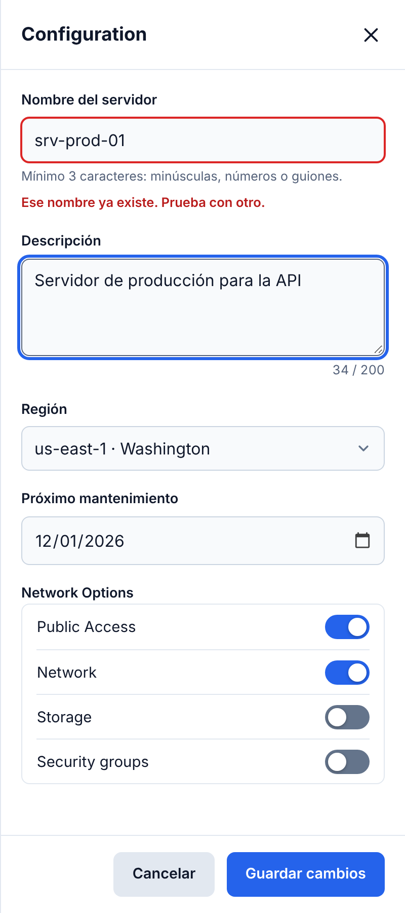
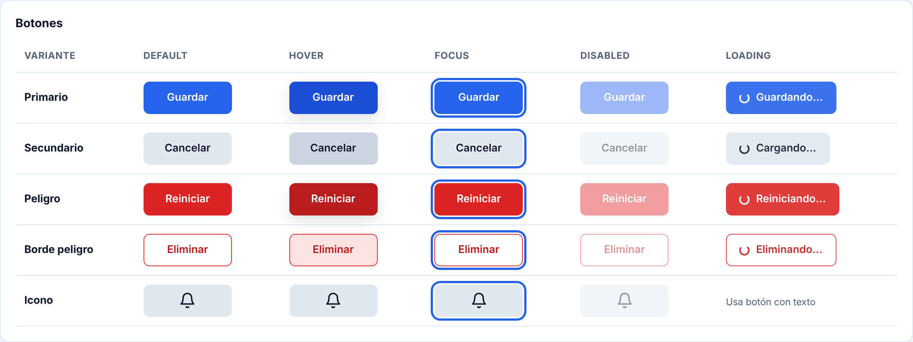
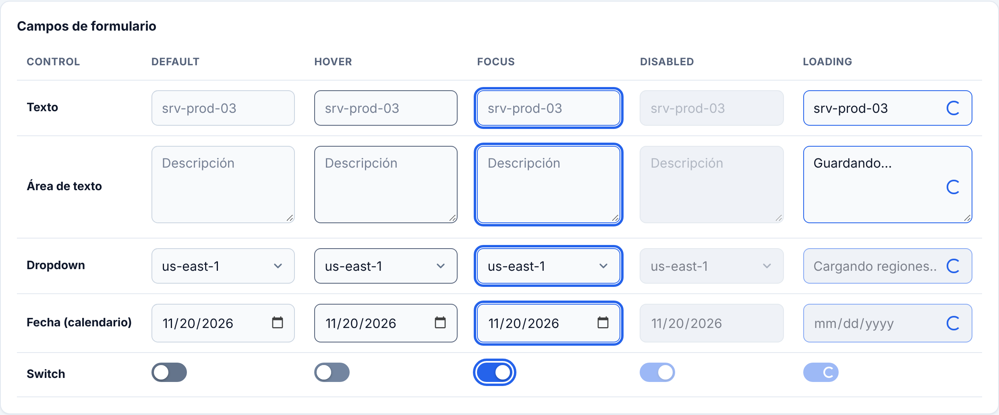
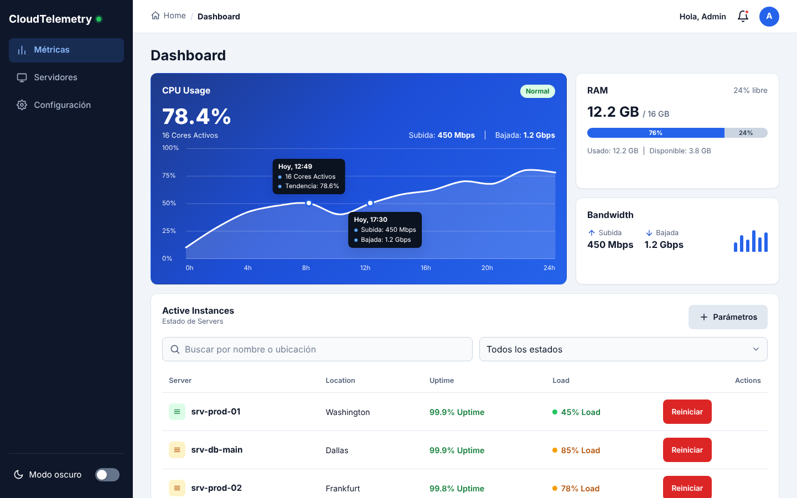
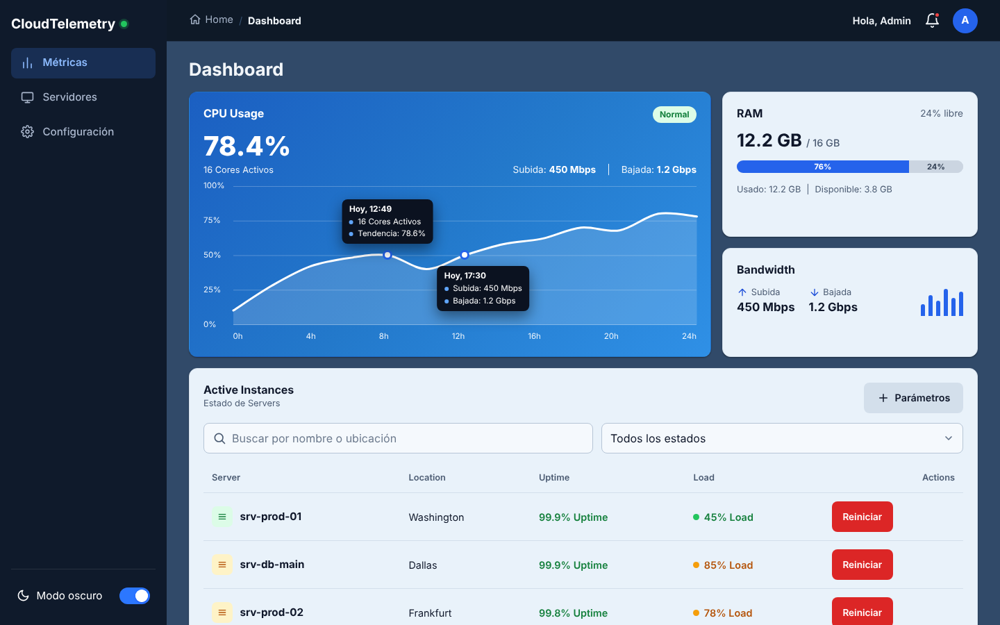
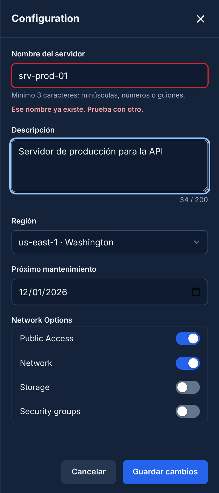

# Fase 4 · Mecanismos de control, estados y tendencias

Galería interactiva con todos los controles y sus estados: [`estados.html`](../estados.html).

## 1. Controles de entrada y navegación

El formulario vive en el Drawer de configuración (Sidebar › Configuración).

| Control | Elemento | Detalles |
|---|---|---|
| Texto | `input[type=text]` | Validación en vivo, mensaje de error, verificación asíncrona del nombre (estado Loading) |
| Área de texto | `textarea` | `maxlength=200` con contador "34 / 200" |
| Datepicker | `input[type=date]` | Calendario nativo, `min` = hoy, icono con hover, tema claro/oscuro |
| Dropdown | `select` | Flecha propia, opciones con colores del tema |
| Switch / toggle | `input[type=checkbox][role=switch]` | 44×24 px, también el toggle de modo oscuro |

## 2. Los 5 estados

| Estado | Cómo se logra |
|---|---|
| Default | Estilo base de `.btn`, `.form-control`, `.switch` |
| Hover | `:hover` (borde más marcado en campos, fondo más oscuro + sombra en botones, brillo en switches) |
| Focus | `:focus-visible`, contorno de 3 px con `--focus-ring` y 2 px de separación (contraste ≥ 3:1 en claro y oscuro) |
| Disabled | Atributo `disabled`: opacidad 45 %, `cursor: not-allowed`, sin sombra ni hover |
| Loading | `.is-loading` + `aria-busy="true"`: spinner, `pointer-events: none` (botones) o `readonly` (campos); el envío queda bloqueado |

Loading real en uso:
- **Nombre del servidor**: al salir del campo verifica 0.9 s si el nombre existe. Si el usuario pulsa "Guardar" durante la verificación, el envío espera a que termine. (`img/f4-form-loading.png`)
- **Guardar cambios**: bloquea todos los campos con `fieldset[disabled]`, no permite cerrar ni reenviar. (`img/f4-guardando.png`)
- **Confirmar** en el modal: spinner, "Reiniciando…", Escape y clic fuera desactivados. (`img/f4-modal-loading.png`)

## 3. Modo oscuro nativo

- Toda la paleta son variables CSS en `:root` (`--bg-*`, `--text-*`, `--blue-*`, `--focus-ring`, sombras…).
- `@media (prefers-color-scheme: dark)` redefine las variables cuando la persona no ha elegido tema.
- El toggle manual (Sidebar en escritorio, header en móvil, y en la galería) fija `data-theme="dark|light"` en `<html>`, que tiene prioridad, y se guarda en `localStorage` (`ct-theme`).
- `color-scheme` + `<meta name="color-scheme">` hacen que el calendario, scrollbars y controles nativos sigan el tema.

Verificado: sin elección previa y con el sistema en oscuro → `data-theme="dark"`; el toggle persiste tras recargar.

| Claro | Oscuro |
|---|---|
|  |  |
|  |  |

Móvil oscuro: `img/f4-movil-oscuro.png`, `img/f4-movil-form.png`.

## 4. Microinteracciones (todas entre 200 y 350 ms, `--t-fast/base/slow`)

| Elemento | Efecto | Duración |
|---|---|---|
| Tarjetas | Hover: sube 3 px y cambia la sombra | 250 ms |
| Botones | Hover: color/sombra; `:active`: escala 0.97 | 200 ms |
| Switch | La perilla se desliza y cambia el color de la pista | 200 ms |
| Ítems del menú | Hover: se desplazan 2 px | 200 ms |
| Modal | Apertura: fondo en fundido + diálogo sube y escala de 0.95 a 1. Cierre: el mismo movimiento a la inversa | 250 ms |
| Drawer | Desliza desde la derecha | 350 ms |
| Errores | Sacudida corta al aparecer | 350 ms |
| Toast | Entra desde abajo, el icono "rebota" | 250–350 ms |

Apertura del modal (cuadros a 40, 120 y 400 ms): `img/f4-modal-apertura-1.png` … `-3.png`. Cierre: `img/f4-modal-cierre.png`.

`prefers-reduced-motion: reduce` reduce las transiciones a ~0 ms (el spinner se mantiene).

## 5. Checklist de la fase

| Requisito | Cumple |
|---|---|
| Texto, textarea, datepicker, switch y dropdown en un formulario | ✔ |
| 5 estados en botones (4 variantes + icono) y campos | ✔ |
| Focus visible accesible | ✔ |
| Loading bloquea reenvío | ✔ |
| Variables CSS + `prefers-color-scheme` + toggle manual | ✔ |
| Hover de tarjetas, transición de botones, animación de modal | ✔ |
