# Reporte técnico de validación

- **Proyecto:** CloudTelemetry · Dashboard SPA responsivo
- **Autor:** Jasiel Rubio
- **Tecnologías:** HTML5 semántico, CSS nativo (Grid + Flexbox), JavaScript vanilla. Sin Bootstrap ni Tailwind.
- **Método de validación:** pruebas en Chromium (Playwright) a 390 px, 768 px y 1440 px, en tema claro y oscuro, con capturas, mediciones del DOM y pruebas de teclado.

## 1. Resumen

| Requisito de la práctica | Resultado | Sección |
|---|---|---|
| 5 estados de cada control | Cumple | 2 |
| Vista responsiva móvil, tableta y escritorio | Cumple | 3 |
| Modo oscuro (variables, `prefers-color-scheme`, toggle) | Cumple | 4 |
| Checklist de las 5 dimensiones de IxD | Cumple | 5 |

## 2. Los 5 estados de cada control

Estados: **Default**, **Hover**, **Focus** (contorno de 3 px visible), **Disabled** y **Loading** (spinner y bloqueo de reenvío). La galería viva está en `estados.html`; en las capturas, Hover y Focus se forzaron desde el navegador para dejarlos fijos.

### 2.1 Botones (primario, secundario, peligro, borde peligro e icono)

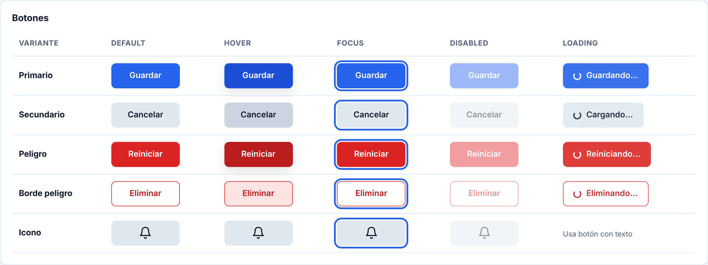

### 2.2 Campos: texto, área de texto, dropdown, fecha y switch

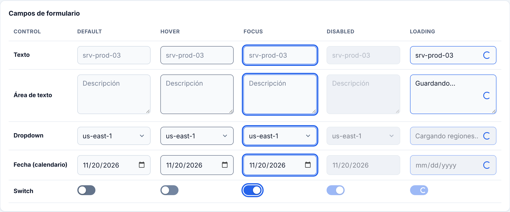

### 2.3 Loading en uso real

| Campo de nombre verificándose | Guardando (campos bloqueados) | Confirmar en el modal |
|---|---|---|
|  | 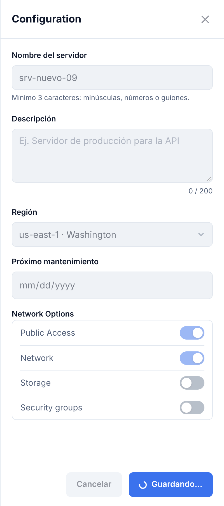 | 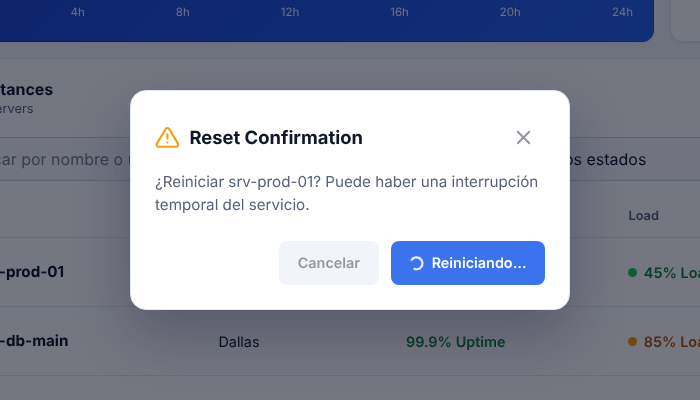 |

Bloqueo de reenvío comprobado: mientras guarda o confirma, el botón tiene `aria-busy`, los campos quedan deshabilitados y `Esc`, ✕ y clic fuera no cierran el panel.

## 3. Vista responsiva

Estrategia mobile-first: reglas base para móvil y `@media (min-width)` para ampliar.

| Ancho | Layout |
|---|---|
| < 768 px | 1 columna, menú hamburguesa, filas de tabla como tarjetas |
| ≥ 768 px | Bento de 2 columnas, tabla real |
| ≥ 1024 px | Sidebar fijo, Bento de 3 columnas, breadcrumbs, gráfica grande |

| Móvil 390 px | Móvil: menú | Móvil: tabla |
|---|---|---|
| 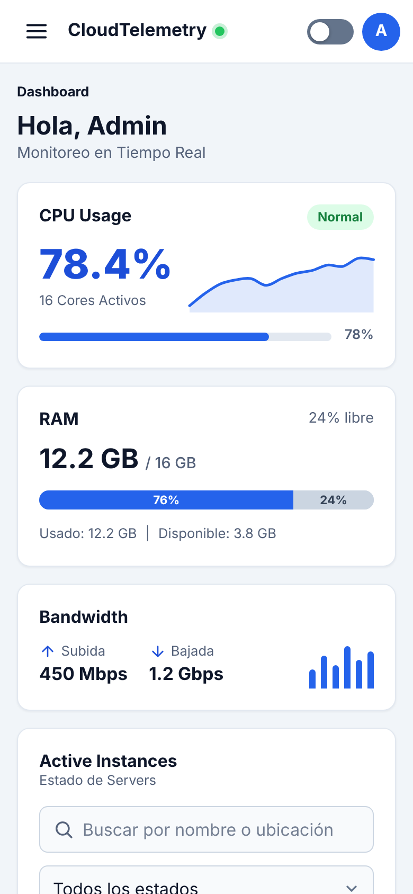{width=32%} | 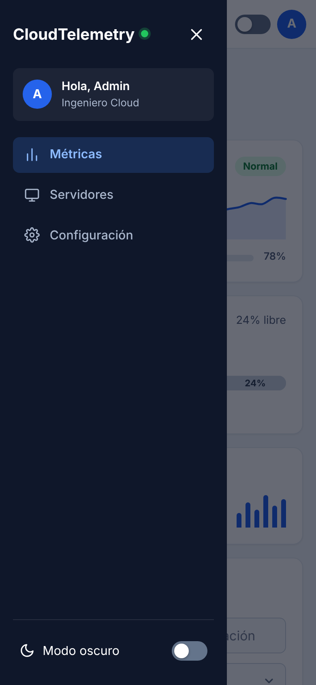{width=32%} | 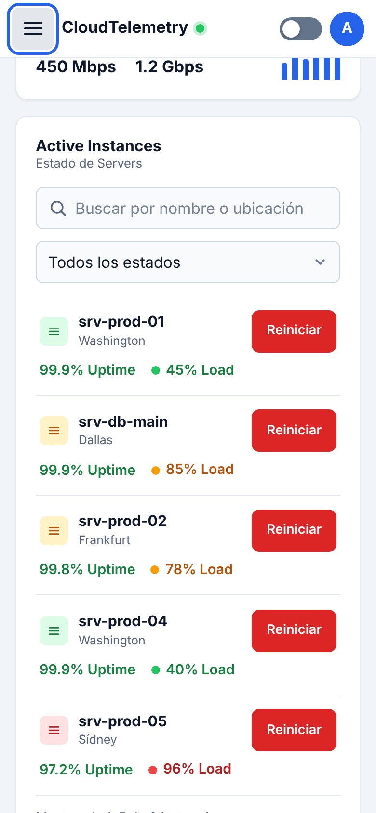{width=32%} |

**Tableta 768 px**

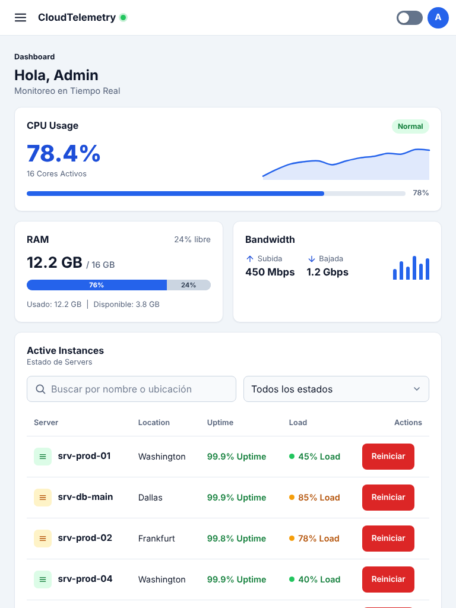{width=60%}

**Escritorio 1440 px**

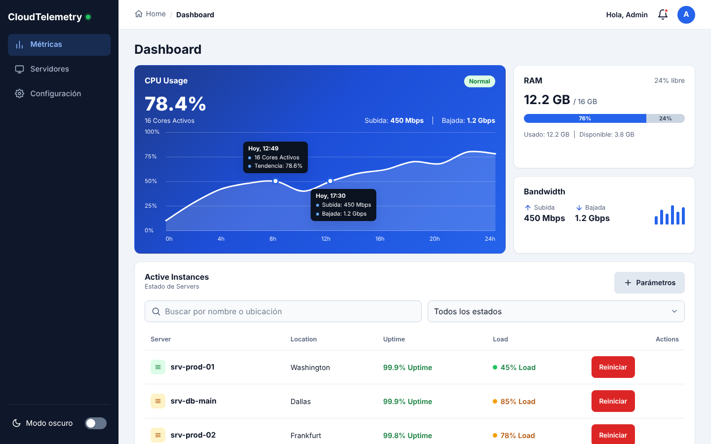

### Formulario y modal

| Drawer (móvil) | Modal de confirmación (escritorio) |
|---|---|
| 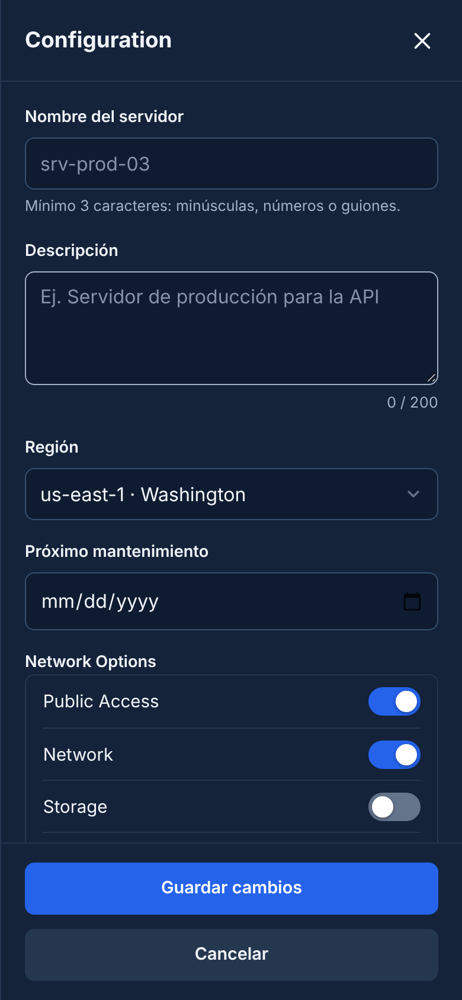{width=40%} | 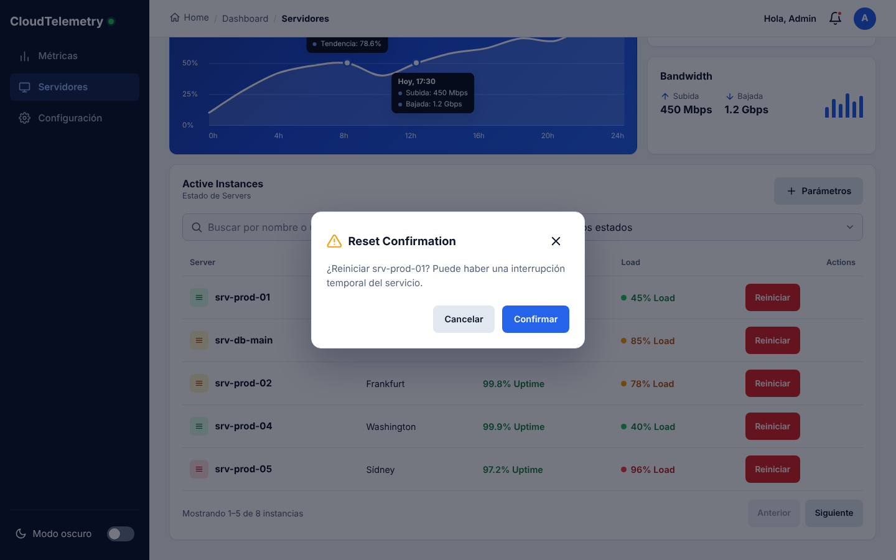 |

## 4. Modo oscuro

- Paleta definida como variables CSS en `:root` (`css/tokens.css`).
- `@media (prefers-color-scheme: dark)` aplica el tema oscuro cuando no hay elección manual.
- Toggle manual (sidebar en escritorio, header en móvil) que fija `data-theme` y se guarda en `localStorage`.

Pruebas: con el sistema en oscuro y sin elección previa, la página carga en oscuro; el toggle cambia el tema y la elección persiste tras recargar.

| Claro | Oscuro |
|---|---|
|  | 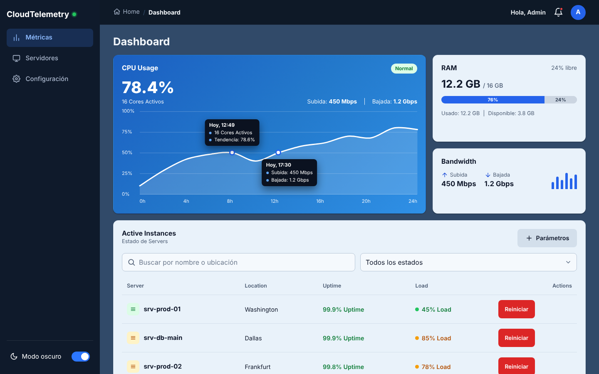 |
| 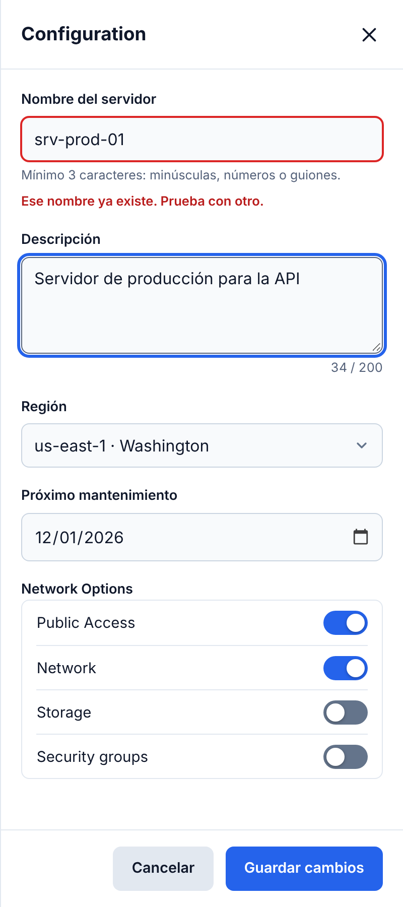{width=60%} | 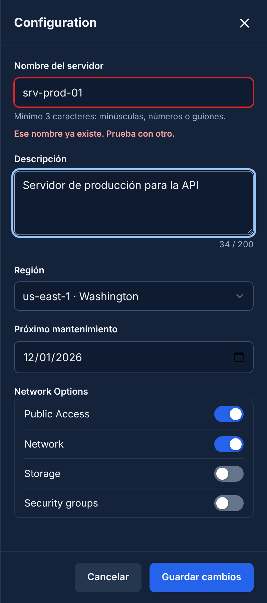{width=60%} |
|  | 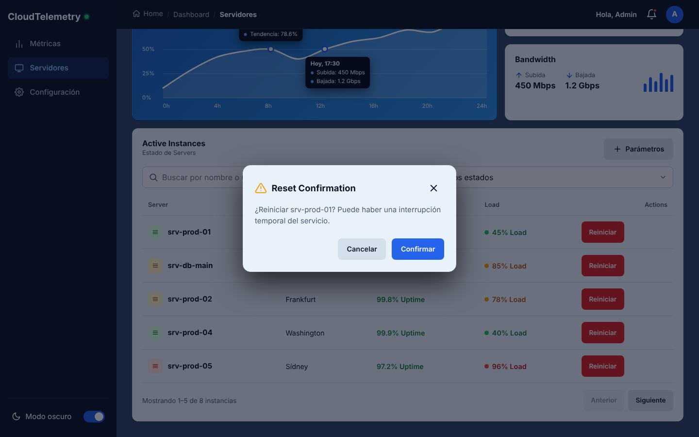 |

Móvil en oscuro:

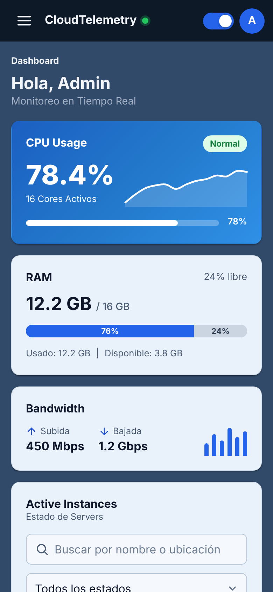{width=32%}

## 5. Checklist de las 5 dimensiones de IxD

| Dimensión | Criterio | Cómo se cumple | Evidencia | ✔ |
|---|---|---|---|---|
| 1D · Palabras | Etiquetas, microcopia y errores claros | `<label>` en cada campo; botones con verbo ("Guardar cambios"); gerundios al cargar ("Guardando…"); errores que indican qué hacer ("Escribe un nombre para el servidor.") | `docs/FASE5.md` | ✔ |
| 2D · Visuales | Iconos consistentes, jerarquía, paleta funcional | Sprite de 18 iconos con el mismo trazo; escala tipográfica definida; verde/ámbar/rojo con texto además de color; contrastes AA (texto 17.9:1, botón azul 5.2:1, foco 5.2:1 claro y 8.8:1 oscuro) | Medición de contraste | ✔ |
| 3D · Objetos | Zonas de toque ≥ 44×44 px | `--touch: 44px` en botones, campos y menú; área ampliada con `::after` en breadcrumbs y nombres de servidor (medían 24 px) | Medición con `getBoundingClientRect` | ✔ |
| 4D · Tiempo | Transiciones de 200–350 ms y spinners | Tokens 200/250/350 ms; auditoría del DOM: solo 0.2, 0.25 y 0.35 s; spinners en botones, campos, switch y modal | Auditoría de duraciones | ✔ |
| 5D · Comportamiento | Reglas ante clic y teclado, consistencia | `Esc` cierra el panel; foco atrapado y devuelto al abridor; acciones destructivas siempre piden confirmación con el foco en Cancelar; mismo patrón de modal, drawer y toast | Prueba de teclado | ✔ |

## 6. Limitaciones conocidas

- Los datos de los servidores y las esperas de carga (0.9–1.5 s) son simulados.
- El calendario y el dropdown usan los controles nativos del navegador, por lo que la lista desplegable y el calendario abierto los dibuja el sistema.
- Algunos rótulos están en inglés (Server, Location, Uptime) por ser vocabulario habitual de DevOps.
- No se probó en Safari ni Firefox; las pruebas fueron en Chromium.
